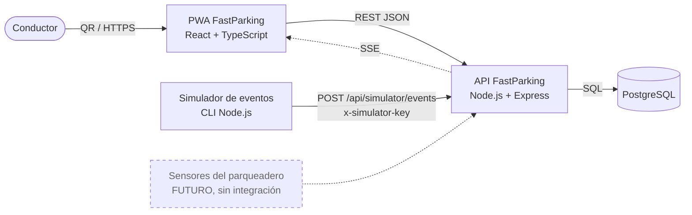

# FastParking

Aplicación web progresiva (PWA) para que los visitantes del **Centro Comercial Parque La Colina (Bogotá)** abran la app desde el **QR del tiquete**, consulten la **disponibilidad de parqueadero por zona y piso**, soliciten una **retención temporal simulada de 7 minutos**, reciban una **reasignación automática** si la zona se ocupa, sigan una **ruta animada en el mapa 3D del sótano** hasta su puesto y **guarden dónde dejaron el vehículo**.

> **Prototipo académico.** La disponibilidad, los eventos de ocupación y los datos de zonas son **simulados e ilustrativos**. No hay integración con sensores, talanqueras ni sistemas de pago del centro comercial. Una retención **no garantiza** el cupo físico.

## Integrantes

| Nombre | Rol |
|---|---|
| Nasly Trujillo | Proyecto individual: análisis, diseño, desarrollo y pruebas |

Docente: Leonardo Valenzuela · Ingeniería de Software · UNINPAHU · 2026

## Tecnologías

| Capa | Tecnología | Por qué |
|---|---|---|
| Lenguaje | TypeScript | Un solo lenguaje tipado en frontend y backend |
| Frontend | React 18 + Vite + vite-plugin-pwa | PWA instalable desde una URL o QR, sin tienda de apps |
| Backend | Node.js + Express | API REST ligera (monolito modular) con SSE nativo |
| Validación | Zod | Valida en el servidor toda entrada (RNF-05) |
| Base de datos | PostgreSQL 16 (driver `pg`, SQL explícito) | Integridad referencial, transacciones y bloqueo de filas para la concurrencia |
| Tiempo real | Server-Sent Events + sondeo de respaldo | Notificaciones servidor → navegador, simples y unidireccionales |
| Pruebas | Vitest + Supertest | Pruebas unitarias y de integración contra PostgreSQL real |
| Contenedores | Docker + Docker Compose | Ejecución reproducible con un solo comando |
| CI | GitHub Actions | Ejecuta verificación de tipos y pruebas en cada push |
| Control de versiones | Git + GitHub | Historial y revisión docente |

## Arquitectura general

Cliente-servidor con **backend en monolito modular**. La PWA solo presenta datos; las reglas (cupo, vencimiento, concurrencia, reasignación) viven en la API y en PostgreSQL. Un **simulador** envía eventos de ocupación a través de un **adaptador desacoplado**, de modo que un sensor real podría conectarse en el futuro sin cambiar las reglas de negocio.



Módulos del backend (`backend/src/modules`): `sessions`, `zones`, `retentions` (incluye el motor de reasignación y el planificador de expiraciones), `events` (adaptador de eventos) y `locations`.

Documento técnico completo: [`docs/documento-tecnico.pdf`](docs/documento-tecnico.pdf) (y su versión editable `.docx`).

Más detalle: [`docs/arquitectura.md`](docs/arquitectura.md), modelo de datos en [`docs/mer.md`](docs/mer.md) y trazabilidad en [`docs/trazabilidad.md`](docs/trazabilidad.md).

## Estructura

```
fastparking/
├─ backend/            API REST (Node.js + Express + TypeScript)
│  ├─ db/migrations/   esquema SQL (MER ejecutable)
│  ├─ db/seed.sql      datos ilustrativos
│  ├─ src/modules/     sessions · zones · retentions · events · locations
│  └─ tests/           pruebas unitarias e integración (CP-01 … CP-09)
├─ frontend/           PWA (React + Vite)
├─ simulator/          simulador de eventos de ocupación + escenarios
├─ docs/               documentación técnica y diagramas
└─ docker-compose.yml  base de datos + API + PWA
```

## Requisitos previos

- Docker Desktop (probado con Docker 28)
- Node.js 20.12 o superior (probado con Node.js 22 y 24) — solo para desarrollo local, pruebas y simulador
- Git

## Instalación y ejecución

### Opción A — Todo con Docker (recomendada para revisar)

```bash
git clone <URL-del-repositorio>
cd fastparking
cp .env.example .env            # en Windows PowerShell: copy .env.example .env
docker compose up --build
```

- PWA: http://localhost:8080 (desde el celular en la misma red: `http://<IP-de-tu-PC>:8080`)
- API: http://localhost:3000/api/health
- Sin token, la PWA muestra la **simulación del tiquete con su QR**; también puedes abrir directamente http://localhost:8080/?t=TIQUETE-0001

### Opción B — Desarrollo local

```bash
# 1. Base de datos
docker compose up -d db

# 2. API
cd backend
cp .env.example .env
npm install
npm run db:seed        # crea tablas y carga datos ilustrativos
npm run dev            # http://localhost:3000

# 3. PWA (otra terminal)
cd frontend
npm install
npm run dev            # http://localhost:5173
```

### Simulador de eventos

Con la API en marcha (usa `SIMULATOR_API_KEY` de `backend/.env` o de la variable de entorno):

```bash
node simulator/simular.mjs zonas                    # ver disponibilidad
node simulator/simular.mjs evento S1-C ENTRADA 2    # entran 2 vehículos a S1-C
node simulator/simular.mjs llenar S1-C              # ocupa toda la zona → provoca reasignación
node simulator/simular.mjs escenario hora-pico      # secuencia de eventos
```

Con Docker (opción A), ejecuta el simulador desde tu equipo con: `SIMULATOR_API_KEY=<la clave de tu .env> node simulator/simular.mjs ...`
(en PowerShell: `$env:SIMULATOR_API_KEY="<clave>"; node simulator/simular.mjs ...`).

**Demostración sugerida (5 min):**

1. Abre http://localhost:8080: aparece el **tiquete simulado con su QR**. Pulsa *Simular escaneo del QR* (o escanéalo con el celular en la misma red).
2. En *Inicio* retén **S1-C** (7 minutos).
3. Ejecuta `node simulator/simular.mjs llenar S1-C`: la PWA avisa que la retención fue **reasignada** a la zona más cercana con cupo.
4. Pulsa *Ir con la ruta* (o, sin retención, toca un **puesto libre en el Mapa** y *Reservar 7 min*): el **mapa 3D del sótano** muestra la flecha con instrucciones de giro hasta tu puesto.
5. Pulsa *Confirmar que estacioné aquí*: la retención queda **UTILIZADA** y *Mi vehículo* muestra la hora de entrada y dónde quedó el carro.
6. En *Billetera* elige un método y paga (simulado): obtienes el comprobante con **QR de salida** y el historial.

## Pruebas

```bash
docker compose up -d db
cd backend
npm test
```

30 pruebas automatizadas: reglas de negocio (unitarias) y casos de prueba CP-01 a CP-11 contra PostgreSQL real (incluida la prueba de concurrencia de dos conductores por el último cupo). Evidencia en [`docs/pruebas/`](docs/pruebas/).

## Variables de entorno

No se suben secretos al repositorio: copia los archivos `.env.example` como `.env`.

| Variable | Dónde | Descripción |
|---|---|---|
| `DATABASE_URL` | backend | Conexión a PostgreSQL |
| `TEST_DATABASE_URL` | backend | Base de datos de pruebas |
| `PORT` | backend | Puerto de la API (3000) |
| `SIMULATOR_API_KEY` | backend / raíz | Clave que exige el endpoint del simulador |
| `RETENTION_MINUTES` | backend | Vigencia de una retención (7) |
| `SESSION_HOURS` | backend | Vigencia de la sesión anónima (12) |
| `EXPIRATION_INTERVAL_MS` | backend | Frecuencia del planificador de expiraciones |
| `TARIFA_POR_MINUTO` | backend | Tarifa ilustrativa en COP (130) |
| `MINUTOS_PARA_SALIR` | backend | Minutos para salir después de pagar (15) |
| `POSTGRES_PASSWORD` | raíz | Contraseña local del contenedor de PostgreSQL |

## API

| Método | Ruta | Requisito |
|---|---|---|
| GET | `/api/health` | RF-01 |
| POST | `/api/sessions` | RF-01 (sesión anónima desde QR) |
| GET | `/api/zones` | RF-02, RF-03, RF-13 |
| POST | `/api/retentions` | RF-04 |
| GET | `/api/retentions/current` · `/api/retentions/:id` | RF-04, RF-05 |
| POST | `/api/retentions/:id/cancel` | RF-08 |
| POST | `/api/retentions/:id/arrive` | RF-16 (llegada confirmada) |
| PUT / GET | `/api/vehicle-location` | RF-09 |
| GET | `/api/sessions/current` | RF-09 (hora de entrada) |
| GET | `/api/payments/quote` | RF-11 (liquidación) |
| POST | `/api/payments` | RF-11 (pago simulado) |
| GET | `/api/payments` | RF-17 (historial) |
| POST | `/api/simulator/events` | RF-06, RF-07, RF-12, RF-15 |
| GET | `/api/events/stream` | RF-06 (SSE) |

Las rutas protegidas requieren la cabecera `X-Session-Id`. Los errores tienen el formato `{ "error": { "code", "message", "details?" } }`.

## Despliegue

Actualmente **no está desplegado en la nube**; se ejecuta localmente con Docker Compose (opción A).

## Limitaciones

- Retención temporal **simulada**, no garantizada (no bloquea físicamente un cupo).
- Disponibilidad **por zona**, no por espacio individual.
- Eventos de ocupación **simulados**; sin conexión a sensores reales.
- Plano **ilustrativo** del sótano; la ruta y la flecha son una **navegación simulada**, sin localización en vivo.
- Pago **simulado** con tarifa ilustrativa ($130/min, configurable): no procesa dinero real ni guarda datos financieros.
- Diseñada solo para celular (en computador se muestra en un marco de teléfono).
